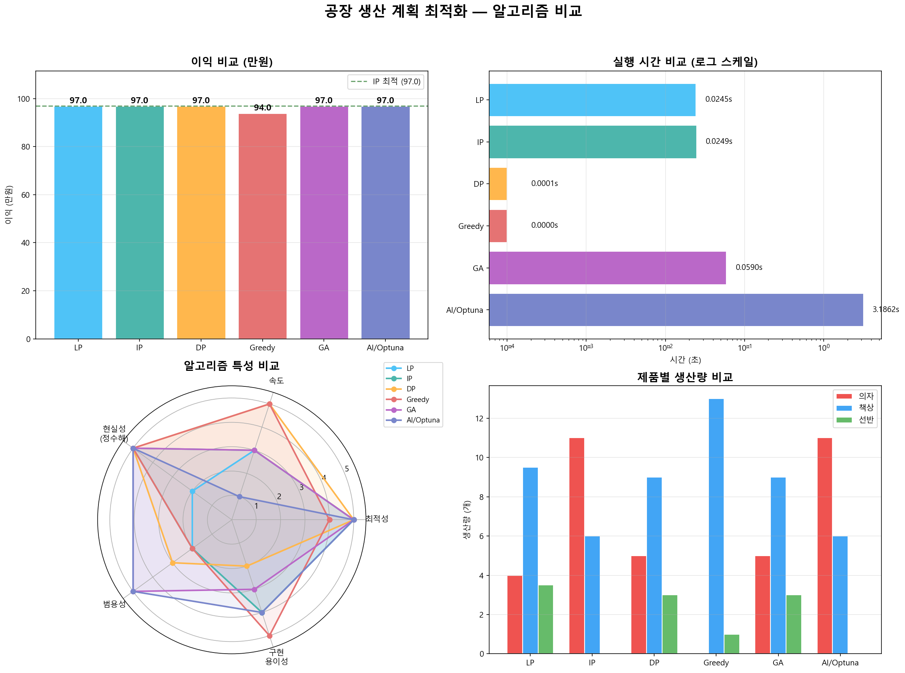

# 공장 생산 계획 최적화: 6가지 알고리즘 비교

같은 공장 생산 계획 문제를 **LP, IP, DP, Greedy, GA, AI(Optuna)** 6가지 최적화 기법으로 풀고, 결과와 실행 시간을 비교했습니다.

## 데이터셋 (문제 정의, `environment.py`)

가구 공장에서 의자, 책상, 선반을 생산할 때, 한정된 자원 안에서 **총 이익을 최대화**하는 생산량을 구하는 문제입니다.

| 항목 | 의자 | 책상 | 선반 | 가용량 |
| --- | --- | --- | --- | --- |
| 이익 (만원/개) | 5 | 7 | 3 | - |
| 기계A 가공 (시간) | 2 | 3 | 1 | 40 |
| 기계B 조립 (시간) | 1 | 2 | 2 | 30 |
| 원자재 (kg) | 3 | 2 | 4 | 45 |

## 소스 구성

```text
solver/11th_practice/
├── environment.py       # 공통 문제 정의 및 해 평가(이익, 자원 사용량, 실현 가능 여부)
├── 1_lp_solver.py       # LP (선형 계획법, PuLP), 연속 해
├── 2_ip_solver.py       # IP (정수 계획법, PuLP), 정수 해와 LP 비교
├── 3_dp_solver.py       # DP (동적 계획법), 자원 상태 기반 탐색
├── 4_greedy_solver.py   # Greedy, 이익 효율이 높은 제품부터 배정
├── 5_ga_solver.py       # GA (유전 알고리즘), 선택·교차·변이
├── 6_ai_solver.py       # AI/Optuna, 베이지안 최적화
├── main_compare.py      # 6개 솔버 일괄 실행 및 비교 요약표 출력
└── visualizer.py        # 비교 그래프 생성(comparison_results.png)
```

## 분석 내용

- 모든 솔버가 같은 `ProductionEnv` 인스턴스를 받아 같은 문제를 풉니다.
- 각 솔버가 낸 해를 `evaluate()`로 평가합니다(총 이익, 자원별 사용량, 제약 충족 여부).
- `main_compare.py`가 솔버별 생산량, 이익, 실행 시간을 표로 정리합니다.

## 결과



## 실행 방법

```bash
pip install pulp optuna matplotlib numpy tabulate
cd 11th_practice
python main_compare.py
```
